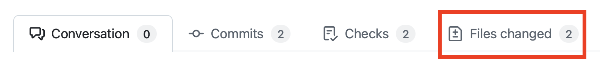

| [← Lección anterior: Gestión de agentes][previous-lesson] |
|:--|

## Revisa el trabajo

A lo largo de este laboratorio has trabajado con GitHub Copilot en varias tareas para mejorar la experiencia de usuario y añadir funcionalidad. Le has pedido a Copilot que añada documentación al código, cree una función de juegos relacionados para que el equipo de diseño pueda iterar sobre ella e implemente funciones de accesibilidad, incluidos los modos de alto contraste y claro. Vamos a revisar los cambios de código y, si hace falta, dar indicaciones a Copilot para mejorar su trabajo.

### Escenario

Como ya hemos señalado varias veces, los fundamentos del diseño de software y DevOps no cambian por incorporar IA generativa. Siempre debemos revisar el código generado y seguir nuestro proceso habitual de DevOps. Con esto en mente, revisaremos las sugerencias de GitHub Copilot para crear la documentación, la función de juegos relacionados y las funciones de accesibilidad antes de activar la revisión para el resto del equipo.

## Seguridad y agente en la nube de GitHub Copilot

Como el agente en la nube de Copilot realiza las tareas de forma asíncrona y sin supervisión, se han establecido ciertas restricciones de seguridad para que todo siga siendo seguro. Entre ellas:

- Copilot solo tiene acceso de lectura al repositorio y acceso de escritura **únicamente** a la rama que utilizará para el código.
- El agente en la nube se ejecuta en GitHub Actions, donde crea un entorno independiente y efímero para trabajar.
- Una persona debe aprobar cualquier flujo de trabajo de GitHub Actions antes de que pueda ejecutarse.
- [El acceso a recursos externos está limitado de forma predeterminada](https://docs.github.com/copilot/how-tos/copilot-on-github/customize-copilot/customize-cloud-agent/customize-the-agent-firewall), incluidos los servidores MCP.

## Revisa la documentación generada

Empezaremos con la primera solicitud de incorporación de cambios (PR) que ha generado el agente en la nube de GitHub Copilot: añadir documentación al código. Para ello, utilizarás la interfaz estándar de PR de GitHub.com.

> [!NOTE]
> Al explorar la PR, es posible que veas una advertencia que indica que el cortafuegos ha bloqueado a GitHub Copilot. Es **lo esperado**, ya que Copilot tiene acceso limitado a recursos externos de forma predeterminada, incluidas las llamadas a servidores MCP externos. Si quieres, puedes [personalizar o deshabilitar el cortafuegos para el agente en la nube de Copilot][agent-firewall].

1. Vuelve al repositorio en github.com.
2. Selecciona **Pull Requests** para abrir la lista de solicitudes.
3. Abre la solicitud cuyo título sea parecido a **Add missing documentation** o algo más descriptivo.

> [!NOTE]
> Si Copilot sigue trabajando en la tarea, la solicitud tendrá la marca **[WIP]**. En ese caso, espera a que termine. Puede tardar unos minutos; puedes hacer una pausa o repasar lo que has aprendido hasta ahora.

4. Cuando la solicitud esté lista, selecciona la pestaña **Files changed** y revisa los cambios.

    

5. Explora el código actualizado, que ahora incluye comentarios de documentación TSDoc y otros comentarios de documentación. Los cambios concretos pueden variar.

    Al revisar los cambios, busca comentarios de documentación TSDoc, convenciones de TypeScript y encabezados de comentario. Proceden de los archivos de instrucciones personalizadas que revisaste al principio del ejercicio 2.

6. Cuando hayas revisado las actualizaciones y todo parezca correcto, vuelve a la pestaña **Conversation** y desplázate hacia abajo.
7. Deberías ver un indicador de que hay flujos de trabajo pendientes de aprobación.
8. Si hay flujos pendientes, selecciona **Approve and run workflows**.

   

9. Deberías ver los flujos de trabajo en cola en la sección de comprobaciones de la solicitud. Si todo va bien, las comprobaciones del proyecto deberían superarse para la aplicación Astro. Puede tardar unos minutos.

## Solicita cambios a GitHub Copilot

Trabajar con Copilot en una solicitud de incorporación de cambios no es una comunicación unidireccional. También puedes mencionar a Copilot en los comentarios de la solicitud o en comentarios en línea sobre el código, igual que harías con otros miembros del equipo. Copilot verá esos comentarios e iniciará otra sesión para resolverlos. Como los resultados no son deterministas, no podemos recomendar un texto exacto. Algunas ideas de lo que puedes pedirle:

- Añadir encabezados de comentario al principio de cada archivo de código con una breve descripción de su función.
- Añadir comentarios de documentación TSDoc a los archivos TypeScript y Astro.
- Crear un README que describa la estructura de la aplicación Astro.

1. Añade un comentario para solicitar un cambio en la documentación generada y menciona a **@copilot**, como harías con cualquier usuario. Puedes utilizar una de las ideas anteriores u otra sugerencia relacionada con la documentación que quieras incluir en el código.
2. Selecciona **View Session** para observar cómo trabaja Copilot. Verás que inicia una nueva sesión para realizar las actualizaciones.
3. Puedes seleccionar **Back to pull request** para volver a la solicitud.

    

4. Cuando Copilot termine los cambios, debería aparecer una nueva confirmación en la solicitud.
5. Selecciona la pestaña **Files changed** para revisar los cambios.

Puedes seguir iterando hasta que estés conforme. Después, puedes marcar la PR como lista para revisión y fusionarla en la rama principal.


## Revisa la función de juegos relacionados

Volvamos a la PR que Copilot ha generado para resolver la incidencia sobre los juegos relacionados en la página de detalles de cada juego.

1. Vuelve al repositorio en GitHub.com.
2. Selecciona la pestaña **Pull Requests**.
3. Selecciona la PR cuyo título sea parecido a **Show related games on the game details page** o algo más descriptivo.
4. Selecciona la pestaña **Files changed** para revisar el código generado.
5. Cuando hayas revisado las actualizaciones y todo parezca correcto, vuelve a la pestaña **Conversation** y desplázate hacia abajo.
6. Deberías ver un indicador de que hay flujos de trabajo pendientes de aprobación.
7. Si hay flujos pendientes, selecciona **Approve and run workflows**.

   

8. Deberías ver los flujos de trabajo en cola en la sección de comprobaciones de la solicitud. Si todo va bien, las comprobaciones del proyecto deberían superarse para la aplicación Astro. Puede tardar unos minutos.
9. **Opcional:** también puedes cambiar a esta rama en tu codespace para probar manualmente la función de juegos relacionados. Ve al codespace, abre el terminal y ejecuta estos comandos (sustituye `<branch-name>` por el nombre de la rama que ha creado Copilot, por ejemplo, **copilot/fix-8**):

    ```bash
    git fetch origin
    git checkout <branch-name>
    ```

Copilot ha creado la función de juegos relacionados. Como antes, puedes trabajar de forma iterativa con el agente en la nube de Copilot para pedir actualizaciones. Por ejemplo, podrías pedirle que cambie el número de juegos relacionados que se muestran o que añada encabezados de comentario y comentarios de documentación TSDoc (recuerda que esta tarea se asignó **antes** de que actualizaras las instrucciones personalizadas). Igual que antes, puedes pedir estos cambios añadiendo un comentario en la pestaña **Conversation**; Copilot lo verá e iniciará una nueva sesión.

## Revisa las funciones de accesibilidad

Por último, revisaremos las funciones de accesibilidad implementadas mediante el agente personalizado de accesibilidad. Esta PR debería incluir el modo de alto contraste que asignaste en el ejercicio 3 y el modo claro que solicitaste desde el panel de agentes en el ejercicio 4.

1. Vuelve al repositorio en GitHub.com.
2. Selecciona la pestaña **Pull Requests**.
3. Selecciona la PR cuyo título sea parecido a **Add high contrast mode to website** o algo más descriptivo.

> [!NOTE]
> Si Copilot sigue trabajando en la tarea, la solicitud tendrá la marca **[WIP]**. En ese caso, espera a que termine. Puede tardar unos minutos.

4. Selecciona la pestaña **Files changed** para revisar el código generado.
5. Revisa la implementación y presta especial atención a:
   - los componentes de interfaz para alternar entre modos;
   - el uso del almacenamiento local para conservar las preferencias del usuario;
   - los cambios de CSS o de estilo para los modos de alto contraste y claro;
   - los atributos de accesibilidad (etiquetas ARIA, navegación con el teclado, etc.);
   - el código JavaScript/TypeScript que gestiona el cambio de modo.

6. Cuando hayas revisado las actualizaciones y todo parezca correcto, vuelve a la pestaña **Conversation** y desplázate hacia abajo.
7. Deberías ver un indicador de que hay flujos de trabajo pendientes de aprobación.
8. Si hay flujos pendientes, selecciona **Approve and run workflows**.

   

9. Deberías ver los flujos de trabajo en cola en la sección de comprobaciones de la solicitud. Si todo va bien, las comprobaciones del proyecto deberían superarse para la aplicación Astro. Puede tardar unos minutos.
10. **Opcional:** puedes cambiar a esta rama en tu codespace para probar manualmente las funciones de accesibilidad. Ve al codespace, abre el terminal y ejecuta estos comandos (sustituye `<branch-name>` por el nombre de la rama que ha creado Copilot):

    ```bash
    git fetch origin
    git checkout <branch-name>
    ```

    Después, inicia la aplicación y prueba los modos de alto contraste y claro en el navegador para comprobar que funcionan correctamente y se mantienen al volver a cargar la página.

Observa cómo el agente personalizado de accesibilidad ha ayudado a Copilot a implementar estas funciones siguiendo las buenas prácticas de accesibilidad. Si detectas algún problema o mejora de accesibilidad, puedes mencionar a **@copilot** en un comentario y pedirle una actualización, como hiciste con las PR anteriores.

## Ejercicio opcional: sigue delegando

El agente en la nube funciona mejor cuando puedes asignarle tareas reales del backlog y dedicarte a otra cosa. Para practicarlo, crea varias incidencias en tu repositorio y asígnaselas a Copilot. Algunas ideas:

- Crear un formulario para indicar el interés de los patrocinadores en la página de detalles del juego.
- Implementar la paginación en la página de lista de juegos.
- Añadir validación de entradas y gestión de errores a los helpers de acceso a datos.

## Resumen

Has completado el itinerario del agente en la nube. A lo largo de estas lecciones:

- **Has inspeccionado los archivos de instrucciones personalizadas del repositorio** para observar después su efecto en el resultado del agente en la nube.
- **Has asignado incidencias al agente en la nube de Copilot** y has visto cómo preparaba el entorno, planificaba y trabajaba de forma asíncrona.
- **Has creado y utilizado un agente personalizado** para accesibilidad, con modos de alto contraste y claro.
- **Has utilizado la página de agentes de Copilot como centro de control** para supervisar la sesión de accesibilidad y orientarla mientras estaba en curso.
- **Has revisado las solicitudes de incorporación de cambios del agente en la nube e iterado sobre ellas**, mencionando a `@copilot` para solicitar cambios y aprobando flujos de trabajo.

## Repaso y pasos siguientes

Has completado el itinerario del agente en la nube. Si quieres seguir explorando, los otros itinerarios complementan lo que has practicado:

- 🖥️ **[Itinerario de VS Code](../../vscode/)**: explora el modo de agente de Copilot Chat y la integración de MCP directamente desde el IDE.
- 💻 **[Itinerario de CLI](../../cli/)**: entrega dos cambios revisados desde el terminal con los modos Plan y Autopilot, aptitudes de agente, un agente de QA personalizado, Playwright MCP, Agent Merge y un puente opcional `/delegate` con el agente en la nube.

En tu propio repositorio, prueba estas ideas:

- Asigna al agente en la nube una incidencia de refactorización o cobertura de pruebas.
- Crea un agente personalizado para otro ámbito.
- Configura `copilot-setup-steps.yml` para otra pila tecnológica.

## Recursos

- [GitHub Copilot][github-copilot]
- [Acerca de los agentes de Copilot][copilot-agents]
- [Asignar incidencias de GitHub a Copilot][assign-issue]
- [Buenas prácticas para el flujo de trabajo de configuración del agente en la nube de Copilot][cloud-agent-best-practices]
- [Configurar el cortafuegos del agente en la nube de Copilot][agent-firewall]

---

| [← Lección anterior: Gestión de agentes][previous-lesson] |
|:--|

[github-copilot]: https://github.com/features/copilot
[cloud-agent-overview]: https://docs.github.com/copilot/concepts/agents/cloud-agent/about-cloud-agent
[assign-issue]: https://docs.github.com/copilot/how-tos/use-copilot-agents/cloud-agent/start-copilot-sessions
[setup-workflow]: https://docs.github.com/copilot/how-tos/copilot-on-github/customize-copilot/customize-cloud-agent/customize-the-agent-environment
[copilot-agents]: https://docs.github.com/copilot/concepts/agents/cloud-agent/about-cloud-agent
[cloud-agent-best-practices]: https://docs.github.com/copilot/how-tos/copilot-on-github/customize-copilot/customize-cloud-agent/customize-the-agent-environment
[agent-firewall]: https://docs.github.com/copilot/how-tos/copilot-on-github/customize-copilot/customize-cloud-agent/customize-the-agent-firewall

[previous-lesson]: ../4-managing-agents/
