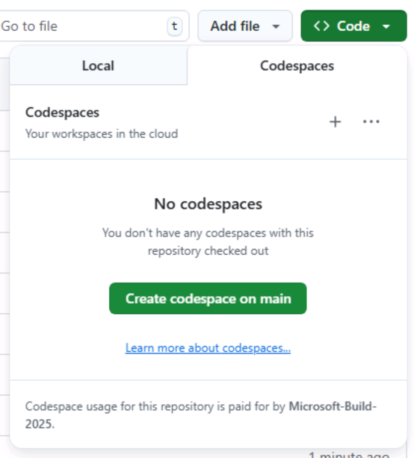

Copilot cloud agent の演習を始める前に、準備が必要です。[Codespace][codespaces] で使う Tailspin Toys リポジトリのコピーを作成します。指示ファイルの編集や、cloud agent が作成した内容のレビューに使います。

## ラボ用リポジトリを設定する

コードを作成するためのリポジトリのコピーとして、[テンプレート][template-repository]からインスタンスを作成します。新しいインスタンスにはラボに必要なファイルがすべて含まれます。演習中はこのリポジトリを使います。

1. 新しいブラウザー ウィンドウで [Tailspin Toys テンプレート][tailspin-template]を開きます。
2. ラボ用リポジトリ ページで **Use this template** ボタンを選択し、**Create a new repository** を選択して、自分用のコピーを作成します。

    

3. GitHub または Microsoft が主催するイベントでワークショップに参加している場合は、メンターの案内に従ってください。それ以外の場合は、GitHub Copilot を利用できる組織に新しいリポジトリを作成できます。

    

4. 作成したリポジトリのパス（**organization-or-user-name/repository-name**）を控えてください。ラボの後半で参照します。

## Codespace を作成する

次に、Codespace を使ってラボの演習を進めます。

[GitHub Codespaces][codespaces] は、ブラウザーで直接コードの作成、実行、デバッグができるクラウド開発環境です。複数のプログラミング言語、拡張機能、ツールに対応した高機能な IDE を利用できます。

1. 作成したリポジトリを開きます。
2. 緑色の **Code** ボタンを選択します。

    

3. **Codespaces** タブを選び、**+** ボタンを選択して新しい Codespace を作成します。

    

Codespace の作成には数分かかりますが、サービスを手動でインストールするよりもずっと速く完了します。その間、これから紹介する GitHub Copilot の機能を確認してもよいでしょう。

> [!CAUTION]
> 今後の演習で Codespace に戻ります。今はブラウザーのタブを開いたままにしてください。

> [!NOTE]
> このワークショップは Codespace またはローカルの [dev container][dev-containers] で動かせるように構成されています。どちらも必要な前提条件がインストールされた環境を提供します。ローカルで実行する場合は、クローンしたリポジトリを VS Code で開き、プロンプトが表示されたら **Reopen in Container** を選択してください。Codespace と同じ dev container が作成されます。

[codespaces]: https://github.com/features/codespaces
[dev-containers]: https://code.visualstudio.com/docs/devcontainers/containers

## まとめ

ラボ用リポジトリのコピーを作成しました。また、Copilot cloud agent と作業する Codespace の作成も開始しました。

## 次のステップ

cloud agent が従うカスタム指示を追加しましょう。[演習 1 - カスタム指示][next-lesson]に進みます。

## リソース

- [GitHub Codespaces の概要][codespaces]
- [テンプレートからリポジトリを作成する][template-repository]
- [Codespaces を始める][codespaces-quickstart]

[tailspin-template]: https://github.com/github-samples/tailspin-toys
[template-repository]: https://docs.github.com/repositories/creating-and-managing-repositories/creating-a-template-repository
[codespaces-quickstart]: https://docs.github.com/codespaces/getting-started/quickstart
[next-lesson]: ../1-custom-instructions/
